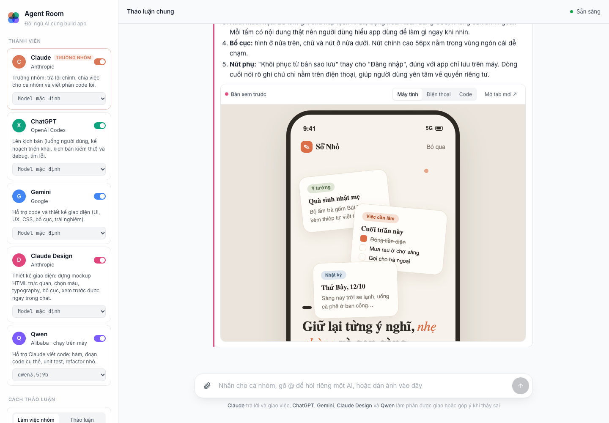
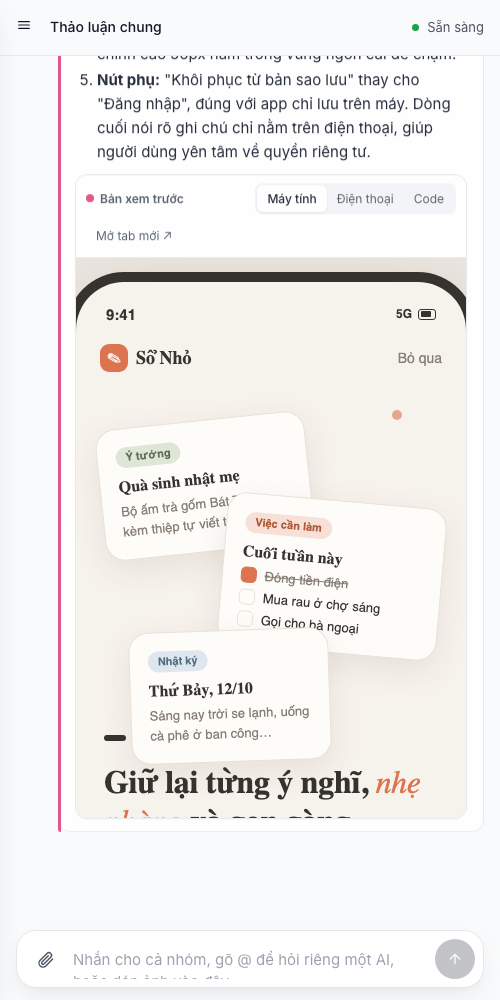

# MultiAgent by Ryan

**Agent Room** là một web app chạy trên máy, nơi bạn làm việc cùng lúc với cả một đội AI: Claude, ChatGPT (Codex), Gemini, Claude Design và Qwen. Mỗi AI có vai trò riêng. Trưởng nhóm trả lời và chia việc, người được giao thì làm, người còn lại chỉ lên tiếng khi thấy có vấn đề.



<p align="center"></p>

## Đội ngũ

| Thành viên | Chạy bằng | Vai trò |
|---|---|---|
| **Claude** | `claude` CLI | Trưởng nhóm: trả lời chính, chia việc, viết code lõi |
| **ChatGPT** | `codex` CLI | Lên kịch bản (luồng người dùng, kế hoạch, kịch bản kiểm thử) và debug |
| **Gemini** | `gemini` CLI | Hỗ trợ code và giao diện |
| **Claude Design** | `claude` CLI | Dựng mockup HTML, xem trước ngay trong khung chat |
| **Qwen** | Ollama (`qwen3.5:9b`), chạy trên máy | Hỗ trợ viết code: hàm, unit test, refactor nhỏ |

## Tính năng

1. **Làm việc nhóm.** Trưởng nhóm giao việc bằng dòng `📋 @Tên: việc`. Ai được giao sẽ làm phần của mình. Ai không được giao sẽ đọc lại và chỉ lên tiếng khi thấy sai, còn không thì chỉ hiện một dòng "đã xem lại và thấy ổn".
2. **Thảo luận.** Tất cả cùng trả lời, phản biện nhau (👍 đồng ý, ⚠️ phản đối) rồi một người tổng kết.
3. **Thấy rõ ai đang nói, ai phản biện ai.** Thanh tiến trình theo từng bước của lượt, thẻ thành viên sáng lên khi đang nói, nhãn ghi rõ đồng ý hay phản đối ai.
4. **Gửi ảnh cho AI xem.** Bấm 📎, dán hoặc kéo thả ảnh vào khung chat. Mỗi tin nhắn tối đa 6 ảnh, mỗi ảnh dưới 10 MB.
5. **Xem trước thiết kế.** Khối `html` trong câu trả lời hiện thành bản xem trước, đổi được giữa khung máy tính và điện thoại, xem code hoặc mở trong tab mới.
6. **Chọn model riêng cho từng AI** ngay trên thẻ thành viên, có cả ô nhập tên model tuỳ ý.
7. Gõ `@Tên` để hỏi riêng một AI, ví dụ `@ChatGPT`, `@Design`, `@Qwen`.
8. Giao diện sáng và tối, dùng tốt trên điện thoại.

## Cài đặt

Cần Node.js 18 trở lên. Không cần cài thêm thư viện nào.

1. Cài và đăng nhập những CLI bạn muốn dùng: [Claude Code](https://docs.anthropic.com/claude-code), [Codex CLI](https://github.com/openai/codex), [Gemini CLI](https://github.com/google-gemini/gemini-cli). AI nào chưa cài thì tắt trên giao diện là được.
2. Muốn dùng Qwen chạy trên máy: cài [Ollama](https://ollama.com) rồi chạy `ollama pull qwen3.5:9b` (khoảng 6 GB, nên có từ 16 GB RAM).
3. Chạy app:

```bash
git clone https://github.com/finntheflap/MultiAgentbyRyan.git
cd MultiAgentbyRyan
PROJECT_DIR=/duong/dan/toi/du-an-cua-ban npm start
```

4. Mở http://localhost:3028

## Biến môi trường

| Biến | Mặc định | Ý nghĩa |
|---|---|---|
| `PROJECT_DIR` | Thư mục cha của repo | Thư mục dự án mà các AI được đọc (chỉ đọc, không sửa) |
| `PROJECT_NAME` | Tên thư mục dự án | Tên dự án đưa vào prompt |
| `PORT` | `3028` | Cổng web |
| `AGENT_ROOM_DATA` | `./data` | Nơi lưu lịch sử chat và ảnh đã gửi |
| `OLLAMA_URL` | `http://127.0.0.1:11434` | Địa chỉ Ollama |

## Cấu trúc

```
server.js          Backend Node thuần: gọi các CLI, Ollama, phát sự kiện realtime qua SSE
public/index.html  Toàn bộ giao diện: HTML, CSS, JS thuần trong một file
data/              Lịch sử chat và ảnh tải lên (không đưa lên git)
```

## Lưu ý

1. Các AI chạy ở chế độ chỉ đọc: Codex dùng sandbox `read-only`, Gemini dùng `--approval-mode plan`. Không AI nào được sửa file trong dự án.
2. Server chỉ lắng nghe ở `127.0.0.1`, không mở ra mạng ngoài.
3. Gemini xem ảnh khá chậm (có thể hơn một phút). Mỗi lượt của một AI tự dừng sau 5 phút nếu chưa có câu trả lời.
4. Danh sách model gợi ý lấy từ các CLI. Tài khoản của bạn có thể chưa dùng được một số model, khi đó app sẽ hiện lỗi ngay trong khung chat.
